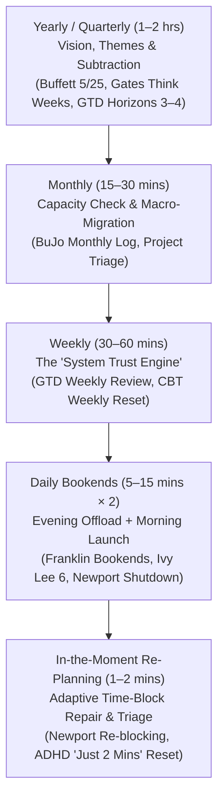
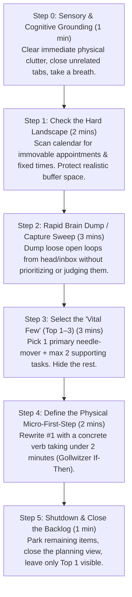

# Planning, Habits, and Review: Behavioral Science & Practitioner Research

This document synthesizes empirical cognitive/behavioral psychology research, interviews and biographical practices of high-performing individuals, and clinical ADHD habit-formation protocols on how people plan, manage tasks, make planning a sustainable habit, and continuously review and improve.

---

## 1. How Often Do They Plan? (Planning Cadences)

Across high-performance interviews, cognitive science, and ADHD clinical protocols, effective planners do **not** plan continuously—they plan at **predictable transition boundaries** using a multi-scale cadence:

| Cadence                       | Typical Duration                                   | Who Uses It & How                                                                                                                                                                                                                                                                                                                                                                                                                                                                                                                                                                                                                                             | Cognitive & Behavioral Mechanism                                                                                                                                                                                                                                                                                                                                                                           |
| :---------------------------- | :------------------------------------------------- | :------------------------------------------------------------------------------------------------------------------------------------------------------------------------------------------------------------------------------------------------------------------------------------------------------------------------------------------------------------------------------------------------------------------------------------------------------------------------------------------------------------------------------------------------------------------------------------------------------------------------------------------------------------ | :--------------------------------------------------------------------------------------------------------------------------------------------------------------------------------------------------------------------------------------------------------------------------------------------------------------------------------------------------------------------------------------------------------- |
| **Daily Bookends (2x/day)**   | **5–15 mins** (Morning & Evening)                  | **[Benjamin Franklin's daily schedule](https://founders.archives.gov/documents/Franklin/01-01-02-0057)** (5 AM *"What good shall I do?"* / 10 PM *"What good have I done?"*); **[The Ivy Lee Method](https://jamesclear.com/ivy-lee)** (evening 6-task selection); **[Cal Newport](https://www.calnewport.com/blog/2013/12/21/deep-habits-the-importance-of-planning-every-minute-of-your-work-day/)** (morning time-blocking + [evening shutdown ritual](https://calnewport.com/drastically-reduce-stress-with-a-work-shutdown-ritual/)); **[Ryder Carroll](https://bulletjournal.com/blogs/bulletjournalist/reflection)** (BuJo daily reflection). | **[Research on unfulfilled goals](https://pubmed.ncbi.nlm.nih.gov/21688924/)** shows that unfinished tasks trigger intrusive thoughts (the [Zeigarnik effect](https://en.wikipedia.org/wiki/Zeigarnik_effect)) that deplete working memory—*until* a concrete plan (when, where, how) is written down. Evening planning frees working memory for sleep; morning planning prevents reactive inbox-checking. |
| **In-the-Moment Re-Planning** | **1–2 mins** (1–3x/day as needed)                  | **[Cal Newport's multi-column time-block grid](https://www.calnewport.com/blog/2013/12/21/deep-habits-the-importance-of-planning-every-minute-of-your-work-day/)** (redrawn when disrupted); **[ADHD CBT transition check-ins](https://chadd.org/for-adults/time-management-planner/)** (at lunch or after meetings).                                                                                                                                                                                                                                                                                                                                      | Plans inevitably collide with reality. Treating a plan as a **steering wheel rather than a prison** prevents abandonment: a 1-minute adjustment restores focus without discarding the whole day.                                                                                                                                                                                                           |
| **Weekly Review & Plan**      | **30–60 mins** (1x/week, usually Fri PM or Sun PM) | **[David Allen's GTD Weekly Review](https://gettingthingsdone.com/2018/08/the-gtd-weekly-review-an-overview/)**; **[Tim Ferriss's calendar & energy audit](https://tim.blog/2018/12/28/past-year-review/)**; **[CBT for ADHD Weekly Reset](https://www.oxfordclinicalpsych.com/view/10.1093/med-psych/9780190235581.001.0001/med-psych-9780190235581)**.                                                                                                                                                                                                                                                                                                | **[Cybernetic Self-Regulation Theory](https://doi.org/10.1017/CBO9781139174794)**: human self-regulation requires a negative feedback loop comparing current state against a target standard. One week is short enough that open loops haven't rotted, and long enough to spot strategic drift.                                                                                                            |
| **Monthly / Sprint Review**   | **15–30 mins** (1x/month)                          | **[Ryder Carroll's BuJo Monthly Migration](https://bulletjournal.com/blogs/bulletjournalist/migration)**.                                                                                                                                                                                                                                                                                                                                                                                                                                                                                                                                                     | Introduces **deliberate friction**: rewriting or re-evaluating unfinished tasks every 30 days forces a conscious keep, schedule, or drop decision, killing "zombie" commitments.                                                                                                                                                                                                                           |
| **Quarterly / Seasonal**      | **1–2 hours** (Every 90 days)                      | **[Bill Gates's "Think Weeks"](https://www.wsj.com/articles/SB111990669451071055)** (reading & synthesizing in isolation); **[Brian Moran's *The 12 Week Year*](https://12weekyear.com/)**.                                                                                                                                                                                                                                                                                                                                                                                                                                                                | **[Empirical goal-setting research](https://pubmed.ncbi.nlm.nih.gov/12345371/)** shows annual goals suffer from [temporal discounting](https://pmc.ncbi.nlm.nih.gov/articles/PMC2847290/) (too distant to regulate daily behavior). A 90-day window creates urgency while providing enough runway for deep outcomes.                                                                                       |
| **Annual Review**             | **2–4 hours** (1x/year)                            | **[Tim Ferriss's "Past Year Review"](https://tim.blog/2018/12/28/past-year-review/)** (80/20 audit); **[Warren Buffett's 5/25 Rule](https://jamesclear.com/buffett-focus)**.                                                                                                                                                                                                                                                                                                                                                                                                                                                                               | Focuses on **subtraction** (what to cut or avoid) and structural/environmental adjustments rather than passive wish lists.                                                                                                                                                                                                                                                                                 |

---

## 2. Planning Routines & Frameworks

### A. Famous Practitioners (Interviews & Biographies)
1. **The Evening-Before Priority Lock ([Ivy Lee](https://jamesclear.com/ivy-lee) & [Tim Ferriss](https://tim.blog/2013/11/03/productivity-hacks/)):**
   * In interviews and essays on [*The Tim Ferriss Show*](https://tim.blog/podcast/), Ferriss notes that high performers decide their primary priority the night before. Deciding in the morning leaves you vulnerable to reactive fire-fighting.
   * **[The Ivy Lee Method](https://jamesclear.com/ivy-lee):** Created in 1918 by consultant Ivy Lee for steel tycoon Charles M. Schwab: at the end of each workday, write down at most **six tasks** for tomorrow in strict order of importance. The next morning, focus solely on task #1 until finished before moving to #2. Anything unfinished rolls over.
   * **[Ferriss's "1-to-3 Macro Rule"](https://tim.blog/2013/11/03/productivity-hacks/):** Wake up, avoid your phone for the first 60–90 minutes, use [*The 5-Minute Journal*](https://tim.blog/2016/01/27/morning-journal/), and write down the **single item** on a small physical card that, if accomplished today, would make you satisfied with your day (and render other tasks easier or unnecessary), plus at most two secondary tasks.
2. **Time-Blocking and the Shutdown Ritual ([Cal Newport](https://calnewport.com/)):**
   * Newport (author of [*Deep Work*](https://calnewport.com/books/deep-work/) and [*Slow Productivity*](https://calnewport.com/books/slow-productivity/)) argues in his [deep habits essay on time-blocking](https://www.calnewport.com/blog/2013/12/21/deep-habits-the-importance-of-planning-every-minute-of-your-work-day/) that unallocated to-do lists invite distraction. Instead, he blocks working hours into dedicated boxes on paper ([Time-Block Planner](https://www.timeblockplanner.com/)): time blocks on the left, rapid capture and notes on the right.
   * **[The Shutdown Complete Ritual](https://calnewport.com/drastically-reduce-stress-with-a-work-shutdown-ritual/):** At day's end, Newport processes loose inbox items, checks the upcoming calendar, writes tomorrow's rough plan, and says a verbal or written phrase (*"Shutdown complete"*). This explicit boundary signals closure to the brain and halts evening rumination.
3. **Aggressive Subtraction & Buffer Time ([Warren Buffett & Bill Gates](https://www.cnbc.com/2017/05/15/bill-gates-learned-this-crucial-lesson-from-warren-buffett.html)):**
   * In a [famous joint interview with Charlie Rose](https://www.cnbc.com/2017/05/15/bill-gates-learned-this-crucial-lesson-from-warren-buffett.html), Bill Gates recounted how Warren Buffett showed him his pocket calendar—and Gates was stunned to find vast stretches of completely blank days. Buffett taught Gates that *"sitting and thinking"* requires unscheduled slack, and packing every minute of a schedule is not a proxy for effectiveness.
   * **[Buffett's 5/25 Rule](https://jamesclear.com/buffett-focus):** Write down your top 25 goals. Circle the top 5. Items 6–25 do *not* become a "work on these in your spare time" list—they become your **Avoid-At-All-Costs list**, because they are appealing enough to seduce your attention away from the top 5.
4. **Daily Bookends, the 13 Virtues Ledger & the "Speckled Axe" ([Benjamin Franklin](https://founders.archives.gov/documents/Franklin/01-01-02-0057)):**
   * In [*The Autobiography of Benjamin Franklin*](https://founders.archives.gov/documents/Franklin/01-01-02-0057), Franklin detailed an integrated personal system governing daily scheduling, habit cultivation, and psychological resilience:
     * **The Scheme of Employment (Daily Schedule):** Franklin built his 24-hour day around the virtue of **Order** (*"Let all your things have their places; let each part of your business have its time"*). His day was anchored by two questions:
       * **Morning Bookend (5:00 AM – 8:00 AM):** Rise, wash, address *Powerful Goodness* (reflection/prayer), ask the Morning Question: *"What good shall I do this day?"*, plan the day's business, study, and breakfast.
       * **Two 4-Hour Work Blocks:** 8:00 AM – 12:00 PM and 2:00 PM – 6:00 PM, separated by a 2-hour midday interval for dining, reading, and reviewing personal accounts.
       * **Evening Bookend (6:00 PM – 10:00 PM):** Put things in their places (physical workspace reset), supper, music/diversion/conversation, followed by the Evening Question: *"What good have I done today?"* and an examination of the day's faults.
     * **The 13-Week Virtue Rotation:** Recognizing that tackling 13 virtues simultaneously caused cognitive overload, Franklin focused on **one focal virtue per week** in his little ledger book, logging daily black dots for any slip-ups. Cycling through the list 4 times a year (13 virtues $\times$ 4 = 52 weeks) gave him structured, cyclical behavioral improvement.
     * **The "Speckled Axe" (The Antidote to Perfectionism):** Franklin candidly confessed that the virtue of **Order** was nearly impossible for him to master because unexpected business interruptions constantly broke his schedule. Distressed by his failures, he recalled the parable of the man grinding an axe who grew exhausted turning the heavy grindstone wheel and concluded: *"I think I like a speckled axe best."* Franklin realized that rigid perfectionism was an exhausting trap, and an imperfect, "speckled" system that is actually maintained is vastly better than abandoning your routine out of guilt.

### B. Empirical Behavioral Studies
1. **[Goal-Setting Theory (Edwin Locke & Gary Latham)](https://pubmed.ncbi.nlm.nih.gov/12345371/):**
   * Across [35+ years of cumulative empirical studies](https://pubmed.ncbi.nlm.nih.gov/12345371/), setting specific, challenging goals dramatically outperforms vague *"do your best"* goals. However, for complex or unfamiliar tasks, high outcome goals can trigger anxiety unless paired with **proximal sub-goals and learning goals** (focusing on discovering strategies rather than immediate perfection).
2. **[Implementation Intentions (Peter Gollwitzer)](https://doi.org/10.1037/0003-066X.54.7.493):**
   * A [landmark meta-analysis of 94 studies](https://doi.org/10.1016/S0065-2601(06)38002-1) demonstrated that translating a vague goal intention (*"I intend to work on X"*) into a concrete **If-Then plan** (*"If situation/time X occurs, then I will initiate physical action Y"*) produces a large boost in attainment ($d = 0.65$), typically doubling or tripling completion rates.
   * **Mechanism:** It delegates behavioral triggering to environmental cues, bypassing conscious willpower and decision fatigue in the moment.
3. **[The Planning Fallacy & Unpacking](https://pubmed.ncbi.nlm.nih.gov/7908681/):**
   * Originally identified by [Daniel Kahneman and Amos Tversky](https://doi.org/10.1016/B978-0-08-024675-8.50027-4) and tested in [daily task estimation studies](https://pubmed.ncbi.nlm.nih.gov/7908681/), people systematically underestimate task durations by 40–100% because they imagine a best-case scenario with zero interruptions. Effective planners counter this via **unpacking** (breaking tasks into sub-steps) and adding a **1.5x buffer** for transitions.

### C. Clinical Studies & Lived Experiences with ADHD
1. **[Planning Deficits in Prospective Memory](https://doi.org/10.1371/journal.pone.0058338):**
   * In a [controlled study of adults with ADHD](https://doi.org/10.1371/journal.pone.0058338), researchers found that the primary bottleneck in executing delayed intentions was not pure memory recall, but **complex task formulation and sequencing**. When a plan is structured externally in advance, execution matches neurotypical controls much more closely.
2. **Manualized CBT for Adult ADHD ([Mary Solanto](https://www.guilford.com/books/Cognitive-Behavioral-Therapy-for-Adult-ADHD/Mary-Solanto/9781609180621), [Steven Safren](https://www.oxfordclinicalpsych.com/view/10.1093/med-psych/9780190235581.001.0001/med-psych-9780190235581), & [J. Russell Ramsay](https://www.routledge.com/Cognitive-Behavioral-Therapy-for-Adult-ADHD-An-Integrative-Psychosocial/Ramsay-Rostain/p/book/9780415815918)):**
   * **[Externalize Memory (Mary Solanto)](https://chadd.org/attention-article/cbt-for-adult-adhd/):** Solanto's manualized Time Management, Organization, and Planning (TOP) program teaches the core maxim: *"If it is not in the planner, it does not exist."* Relying on internal working memory guarantees dropped commitments.
   * **[Shrink the First Step (Solanto & Ramsay)](https://www.additudemag.com/cbt-for-adhd-cognitive-behavioral-therapy-adults/):** Solanto's second maxim is: *"If you are having trouble getting started, the first step is too big."* Tasks must be broken down until the first step is a concrete physical verb taking 2–5 minutes (e.g., *"Open the PDF and write down one number"*).
   * **[Hard Landscape vs. Soft Backlog (CHADD Planner Guidance)](https://chadd.org/for-adults/time-management-planner/):** Restrict the calendar strictly to date/time commitments; isolate a **Top 1 to Top 3 Focus Shelf** to protect against the executive paralysis of an unbounded backlog.
   * **[Time-Slicing with Permission to Stop (J. Russell Ramsay)](https://www.additudemag.com/adhd-procrastination-cbt-techniques/):** Commit to working on an aversive task for just **10 minutes** (or 2 minutes) with explicit permission to stop when the timer rings. Lowering activation energy defeats emotional avoidance.

---

## 3. Practical Planning Steps: How to Plan Without Overwhelm

A common failure mode—especially for people with ADHD or executive fatigue—is sitting down to plan and immediately feeling paralyzed. This occurs when planning is treated as an unstructured, open-ended question (*"What should I do with my life/day?"*) rather than a bounded, mechanical checklist.

The key behavioral rule: **Never stare at your entire backlog when deciding what to do today.** Planning must follow an unambiguous, progressive workflow that separates capture from decision-making:

### The 10-Minute Anti-Overwhelm Daily Planning Protocol

| Step | Time | What to Do | What to AVOID (The Overwhelm Traps) |
| :--- | :--- | :--- | :--- |
| **0. Sensory Grounding** | **1 min** | Set a physical timer for 10 minutes. Grab a drink or turn on focus music. Close all browser tabs except today's log. | **Don't** start by checking email, chat notifications, or social feeds. |
| **1. Grounding in the Hard Landscape** | **2 mins** | Open your calendar. Look *only* at fixed-time appointments and hard commitments for today. Count the actual free hours between them (e.g., "I only have 2.5 hours of discretionary time today, not 8 hours"). Add a 30-minute transition buffer. | **Don't** treat the calendar as a wish list for flexible tasks. Don't assume 100% of open hours can be spent on deep work. |
| **2. Rapid Capture Sweep** | **3 mins** | Brain dump any nagging open loops that accumulated in your head since yesterday into your scratchpad or inbox. Just list them raw (e.g., *"call mechanic", "submit expense report", "draft proposal"*). | **Don't** organize, categorize, tag, or prioritize at this step. Treat capture as pure typing. |
| **3. The "Vital Few" Selection (Top 1–3)** | **3 mins** | Ask **[Tim Ferriss's core question](https://tim.blog/2013/11/03/productivity-hacks/)**: *"If I only completed ONE thing today and had to stop, which task would make me satisfied with my day?"* Pick that as **Task #1**. Select at most **2 secondary tasks**. | **Don't** create a list of 15 "must-dos." An infinite daily list guarantees guilt, fatigue, and executive shutdown. |
| **4. Deconstruct the First Step (Gollwitzer If-Then)** | **2 mins** | Look at Task #1. Ask **[Mary Solanto's question](https://chadd.org/attention-article/cbt-for-adult-adhd/)**: *"Is the first step small enough?"* If Task #1 is "Work on budget", rewrite the first physical micro-step: *"Open budget.xlsx and enter row 1 expenses"*. Frame it as an [If-Then implementation intention](https://doi.org/10.1037/0003-066X.54.7.493): *"When I sit down at 9:00 AM, I will open budget.xlsx"*. | **Don't** leave abstract projects ("deal with taxes") on today's list. Ambiguity creates initiation paralysis. |
| **5. Park and Hide the Rest** | **1 min** | Move any other dump items into your inbox, Someday/Maybe list, or backlog. **Close the backlog.** Leave only your **Top 1–3 Focus Shelf** visible on your screen or desk. | **Don't** keep the full backlog open in your peripheral vision while working. Out of sight prevents cognitive fatigue. |

---

### The Anti-Paralysis Rules for Difficult Days

When burnout, poor sleep, or an ADHD executive freeze strikes, even a 10-minute planning protocol can feel exhausting. Use these clinical emergency fallbacks:

1. **The "Rule of 1" (The Floor Day):**
   * If picking 3 tasks feels impossible, reduce your daily goal to **exactly ONE single task**. Once that single item is done, you have officially won the day. Any additional work is bonus credit.
2. **The 2-Minute Physical Entry:**
   * If you cannot bring yourself to start Task #1, give yourself **[Ramsay's permission to stop](https://www.additudemag.com/adhd-procrastination-cbt-techniques/)**: *"I will open the file and look at it for 120 seconds. If I still feel paralyzed after 2 minutes, I am allowed to close it without shame."* In over 80% of instances, simply crossing the activation threshold breaks the paralysis.
3. **The "Done List" Instead of a "To-Do List" (Reverse Planning):**
   * On severely scattered days, put away the planner completely. Take a blank sheet of paper and write down things **after** you do them (*"10:15 - Answered landlord email"*, *"11:00 - Emptied dishwasher"*). This provides immediate visual dopamine and builds positive momentum without the threat of an uncompleted to-do list.

---

## 4. How Do They Make Planning a Sustainable Habit?

### A. General Population Habit Science
* **[The Real Habit Timeline & Resilience to Single Misses (Phillippa Lally)](https://doi.org/10.1002/ejsp.674):**
  * University College London researchers [tracked real-world habit formation](https://doi.org/10.1002/ejsp.674) and debunked the "21-day myth": automaticity actually takes between **18 and 254 days** (median **66 days**).
  * **Crucial finding:** **Missing a single opportunity to perform a habit did not materially affect the long-term automaticity curve.** Habits die not from a missed day, but from the all-or-nothing emotional abandonment (*"I broke my streak, so I failed"*) that follows a miss.
* **[Context Cues Over Willpower (Wendy Wood)](https://us.macmillan.com/books/9781250159076/goodhabitsbadhabits):**
  * USC researcher Wendy Wood's [empirical habit studies](https://psycnet.apa.org/record/2002-02944-004) show that ~43% of daily behaviors are enacted automatically in consistent contexts. People who score highest on trait "self-control" actually use *less* effortful willpower—they design low-friction environments where the desired cue (e.g., an open notebook or pinned app window) sits directly in their physical path.
* **[Tiny Habits & Anchor Moments (BJ Fogg)](https://tinyhabits.com/):**
  * Under Stanford researcher BJ Fogg's [Fogg Behavior Model ($B = MAP$: Behavior = Motivation + Ability + Prompt)](https://behaviormodel.org/), motivation fluctuates too wildly to rely on. Instead, scale a planning habit down to a **30-second tiny version** anchored to a reliable daily event: *"After I set down my morning coffee mug [Anchor], I will read or write my Top 3 tasks for today [Tiny Habit]."*

### B. ADHD Habit Formation & Sustainability
Because ADHD involves tonic/phasic dopamine differences in the brain's reward and habit pathways, standard repetition takes longer to become automatic and is vulnerable to novelty decay. Adults with ADHD sustain planning habits through five specific adaptations:
1. **[Point-of-Performance Salience (Russell Barkley)](https://www.russellbarkley.org/factsheets/ADHD_EF_and_SR.pdf):** Barkley emphasizes that ADHD is a disorder of *enacting what you know at the point of performance*. A planner closed in a bag or an app buried in a folder ceases to exist. The Today view must remain visually open on a screen, pinned as a widget, or physically blocking the keyboard.
2. **[Immediate Dopamine & Self-Reward (Steven Safren)](https://pmc.ncbi.nlm.nih.gov/articles/PMC2909688/):** Because of [temporal reward discounting in ADHD](https://pmc.ncbi.nlm.nih.gov/articles/PMC2847290/), distant outcomes do not reinforce daily habits. Safren's CBT protocol pairs planning and task milestones with immediate sensory or self-rewards (a favorite drink, music playlist, tactile pen, or satisfying visual completion feedback).
3. **[The "Minimum Viable Day" (Elastic Habits)](https://stephenguise.com/elastic-habits-book/):** Instead of a rigid 20-minute routine that collapses on a low-energy day, establish a non-punitive baseline floor (e.g., *"Write 1 bullet in today's log"*) so the routine stays alive even during chaotic days.
4. **Novelty Refresh Without System Destruction:** When dopamine fades after 4–8 weeks, neurodivergent users often abandon their app and spend hours setting up a new one. Sustainable ADHD planners keep the **same underlying Markdown files/system** while refreshing surface novelty (changing a theme, switching between keyboard rapid-log and visual views, or pairing paper capture with digital review).
5. **[Social Scaffolding & Body Doubling](https://arxiv.org/abs/2603.17258):** Recent [HCI research with ADHD adults](https://arxiv.org/abs/2603.17258) and [virtual body-doubling studies](https://arxiv.org/abs/2509.12153) show that doing a morning check-in or Friday review alongside a co-working stream, partner, or coach turns an executive-function chore into a low-friction social ritual.

---

## 5. How Do They Review and Improve?

### A. The Cognitive Power of Reflection
* **[The 23% Performance Boost from 15 Minutes of Reflection (Harvard Business School)](https://www.hbs.edu/faculty/Pages/item.aspx?num=46308):**
  * In [controlled lab and field experiments](https://papers.ssrn.com/sol3/papers.cfm?abstract_id=2414478), researchers Giada Di Stefano, Francesca Gino, Gary Pisano, and Bradley Staats found that employees who spent the **final 15 minutes of each workday reflecting and writing** down what they learned performed **23% better** after 10 days than peers who spent those same 15 minutes working longer.
  * **Mechanism:** Action alone does not produce improvement; deliberately articulating *why* something worked or failed builds self-efficacy and updates mental models.

### B. Review Routines in Practice
* **[Benjamin Franklin's 13-Week Virtue Rotation](https://www.ushistory.org/documents/virtues.htm):** Franklin audited a single focal habit per week across a 13-week cycle, pairing his 10 PM reflection (*"What good have I done today?"*) with targeted, one-bottleneck-at-a-time improvement.
* **[Tim Ferriss's Past Year Review (80/20 Energy Audit)](https://tim.blog/2018/12/28/past-year-review/):**
  * Instead of making wishful New Year's resolutions, Ferriss reviews his calendar week by week from the past year with two columns: **Peak Positive (+)** and **Peak Negative (-)**.
  * He identifies the top 20% of activities, people, and projects that produced 80% of his positive outcomes (and blocks them onto the new year's calendar *first*), while placing the top 20% energy drains onto a strict **"Not-To-Do" list**.
* **[Ryder Carroll's Migration as an Editorial Filter](https://bulletjournal.com/blogs/bulletjournalist/migration):**
  * In the Bullet Journal method, reviewing is not passive bookkeeping—it is active triage. Unfinished tasks are scrutinized one by one: *Is this still worth my time?* Crossing out obsolete tasks is celebrated as intentional focus rather than failure.
* **[David Allen's GTD Weekly Review](https://gettingthingsdone.com/2018/08/the-gtd-weekly-review-an-overview/):**
  * **Get Clear:** Empty loose capture inboxes to zero.
  * **Get Current:** Review the past 7 days of calendar events (for missed follow-ups) and upcoming 14 days; verify every active project has a concrete physical next action.
  * **Get Creative:** Scan Someday/Maybe lists and higher horizons for emerging ideas.

### C. ADHD Review & Improvement: Compassionate Debugging
Standard review sessions often backfire for adults with ADHD when a wall of red "overdue" tasks triggers shame, rejection sensitivity, and avoidance. [Clinical CBT protocols for ADHD](https://www.additudemag.com/cbt-for-adhd-cognitive-behavioral-therapy-adults/) reframe review as **non-judgmental problem-solving**:
1. **[Treat Breakdowns as Engineering Data, Not Moral Failure](https://pmc.ncbi.nlm.nih.gov/articles/PMC2909688/):**
   * Instead of asking *"Why lacked discipline?"*, ask *"Where did friction happen?"*:
     * *Was the first step too ambiguous?* → Rewrite as a 2-minute physical verb.
     * *Was it scheduled during an afternoon energy crash?* → Re-tag with `@low-energy` or move to morning.
     * *Did the cue fail?* → Move the reminder or note directly into the physical line of sight.
2. **[The Clean-Slate / Triage Reset](https://chadd.org/for-adults/time-management-and-adhd-to-do-lists/):**
   * When illness, travel, or hyperfocus on another project creates a multi-day gap, use an explicit re-entry ritual: archive old daily logs without penalty, surface only recent open loops, pick **one small task for today**, and resume immediately.
3. **[Evaluate Environmental Fit Over Streaks](https://pmc.ncbi.nlm.nih.gov/articles/PMC7863422/):**
   * Review what environmental conditions helped you start (time of day, location, body doubling, duration buffers) rather than tracking punitive completion streaks.

---

## 6. Further Reading & Reference Links

* **Famous Practitioner Routines:**
  * [The Ivy Lee Method: The Daily Routine Experts Recommend for Peak Productivity](https://jamesclear.com/ivy-lee)
  * [Cal Newport: Deep Habits — Planning Every Minute of Your Work Day](https://www.calnewport.com/blog/2013/12/21/deep-habits-the-importance-of-planning-every-minute-of-your-work-day/)
  * [Cal Newport: Drastically Reduce Stress with a Work Shutdown Ritual](https://calnewport.com/drastically-reduce-stress-with-a-work-shutdown-ritual/)
  * [Tim Ferriss: The Past Year Review (Instead of New Year's Resolutions)](https://tim.blog/2018/12/28/past-year-review/)
  * [Tim Ferriss: Morning Journaling & The 1-to-3 Priority Rule](https://tim.blog/2013/11/03/productivity-hacks/)
  * [Warren Buffett's "2 List" (5/25) Strategy for Focus](https://jamesclear.com/buffett-focus)
  * [Bill Gates & Warren Buffett on Protecting Blank Calendar Time](https://www.cnbc.com/2017/05/15/bill-gates-learned-this-crucial-lesson-from-warren-buffett.html)
  * [Benjamin Franklin's Daily Schedule & 13 Virtues](https://founders.archives.gov/documents/Franklin/01-01-02-0057)
  * [Ryder Carroll: Bullet Journal Migration](https://bulletjournal.com/blogs/bulletjournalist/migration) and [Daily Reflection](https://bulletjournal.com/blogs/bulletjournalist/reflection)
  * [David Allen: The GTD Weekly Review Overview](https://gettingthingsdone.com/2018/08/the-gtd-weekly-review-an-overview/)
* **Behavioral Science & Psychology Studies:**
  * [Consider It Done! Plan Making Can Eliminate the Cognitive Effects of Unfulfilled Goals (Masicampo & Baumeister, PubMed)](https://pubmed.ncbi.nlm.nih.gov/21688924/)
  * [Implementation Intentions: Strong Effects of Simple Plans (Peter Gollwitzer, DOI)](https://doi.org/10.1037/0003-066X.54.7.493)
  * [Building a Practically Useful Theory of Goal Setting and Task Motivation (Locke & Latham, PubMed)](https://pubmed.ncbi.nlm.nih.gov/12345371/)
  * [Exploring the "Planning Fallacy": Why People Underestimate Task Completion Times (Buehler et al., PubMed)](https://pubmed.ncbi.nlm.nih.gov/7908681/)
  * [How Are Habits Formed: Modelling Habit Formation in the Real World (Phillippa Lally et al., Wiley)](https://doi.org/10.1002/ejsp.674)
  * [Habits in Everyday Life: Thought, Emotion, and Action (Wendy Wood et al., APA)](https://psycnet.apa.org/record/2002-02944-004)
  * [The Fogg Behavior Model & Tiny Habits (BJ Fogg)](https://behaviormodel.org/)
  * [Learning by Thinking: How Reflection Aids Performance (Di Stefano, Gino, Pisano, & Staats, HBS/SSRN)](https://papers.ssrn.com/sol3/papers.cfm?abstract_id=2414478)
* **ADHD Clinical Research & CBT Guides:**
  * [Complex Prospective Memory in Adults with ADHD (Fuermaier et al., PLOS ONE)](https://doi.org/10.1371/journal.pone.0058338)
  * [CBT for Adult ADHD: Targeting Executive Dysfunction (Mary Solanto, CHADD Overview)](https://chadd.org/attention-article/cbt-for-adult-adhd/)
  * [Cognitive Behavioral Therapy for Adult ADHD (Steven Safren et al., PMC)](https://pmc.ncbi.nlm.nih.gov/articles/PMC2909688/)
  * [CBT Techniques for ADHD Procrastination & Task Initiation (J. Russell Ramsay, ADDitude)](https://www.additudemag.com/adhd-procrastination-cbt-techniques/)
  * [Executive Functions and Self-Regulation in ADHD (Russell Barkley Fact Sheet)](https://www.russellbarkley.org/factsheets/ADHD_EF_and_SR.pdf)
  * ["Not Just Me and My To-Do List": Challenges of Task Management for Adults with ADHD (Chen et al., arXiv)](https://arxiv.org/abs/2603.17258)
